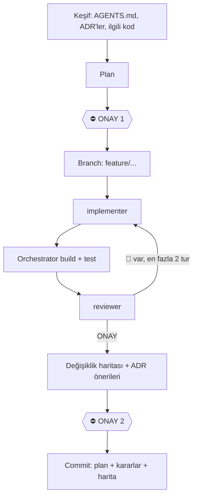

# OrderService — AI Orkestrasyon Denemesi

Bu repo iki şey içerir:

1. **OrderService**: Ekip standardımıza (`vertical-slice-dotnet` skill'i) göre yazılmış küçük bir .NET 8 sipariş API'si.
2. **AI çalışma yapısı**: Claude Code ile özellik geliştirmeyi planlı, denetlenebilir ve anlaşılır hale getiren agent, skill, hook ve karar kayıtları.

Asıl amaç ikincisi. OrderService, yapıyı gerçek bir kod üzerinde denemek için var.

---

## İçindekiler

- [Çözmeye çalıştığımız sorun](#çözmeye-çalıştığımız-sorun)
- [Temel kavramlar](#temel-kavramlar)
- [Dosya haritası](#dosya-haritası)
- [Agent'lar](#agentlar)
- [/feature akışı](#feature-akışı)
- [Hook'lar](#hooklar)
- [Kararların kaydı: commit mesajı ve ADR](#kararların-kaydı-commit-mesajı-ve-adr)
- [Öğrenme döngüsü](#öğrenme-döngüsü)
- [Paralel çalışma (worktree)](#paralel-çalışma-worktree)
- [AGENTS.md / CLAUDE.md nasıl yazılır](#agentsmd--claudemd-nasıl-yazılır)
- [Proje bazlı ve global yapı](#proje-bazlı-ve-global-yapı)
- [Öğrendiğimiz dersler ve sınırlar](#öğrendiğimiz-dersler-ve-sınırlar)
- [OrderService](#orderservice)
- [Yol haritası](#yol-haritası)

---

## Çözmeye çalıştığımız sorun

AI ile geliştirme hızlıdır ama bir süre sonra **kodun sahipliği kaybolur**: kodu AI yazar, sorumluluk geliştiricide kalır. "Bu kod nerede, ne işe yarıyor, neden böyle?" sorularının cevabı zamanla bulunamaz olur.

Bu yapının amacı daha fazla otomasyon değil, **otomasyonu kontrol altında tutmak**:

- Kod yazılmadan önce geliştirici planı onaylar.
- Her iş bağımsız bir gözle review edilir.
- Build ve test atlanamaz.
- Her değişikliğin "ne, nerede, neden" bilgisi kayda geçer.

> Orkestrasyon, sahiplik sorununu tek başına çözmez; kontrolsüz kurulursa büyütür. Önce yapı ve doğrulama, sonra otomasyon.

---

## Temel kavramlar

**Agent döngüsü.** Claude Code'un yaptığı her şey tek bir döngüdür: *oku → planla → uygula → doğrula → gerekirse tekrar*. Tüm yapı bu döngüyü iki uçtan iyileştirir: başa daha iyi **bağlam**, sona daha iyi **doğrulama**.

**Katmanlar:**

| Katman | Soru | Bu repodaki karşılığı |
|---|---|---|
| İnsan | Ne yapılacak, onay var mı? | İki onay noktası, push ve merge |
| Bağlam | AI neyi bilmeli? | `AGENTS.md`, `vertical-slice-dotnet` skill'i, `docs/decisions/` |
| Yürütme | İşi kim yapar? | Orchestrator (ana oturum), `implementer`, `reviewer` |
| Doğrulama | Doğru mu yapıldı? | Build, test, `verify` hook'u |
| Teslim | Nasıl ana dala girer? | Branch → PR → merge (insan) |

**Subagent ve context.** Her subagent **kendi boş context window'u** ile başlar ve ana oturuma yalnızca son raporunu döner. Örneğin reviewer ~40–57 bin token harcayıp ana sohbete birkaç bin tokenlık rapor getirdi. Sonuçları:

- Ana oturumun bağlamı temiz kalır; maliyet azalmaz, genelde artar.
- Subagent ana sohbeti **görmez**; görev metni kendi başına anlaşılır olmalı.
- Subagent, **büyük iş yapıp küçük sonuç döndüğünde** değerlidir (keşif, review, bağımsız uygulama).

**Orchestrator ayrı bir program değildir.** `/feature` yazıldığında ana Claude oturumu bu rolü üstlenir. Bu repoda açılan her oturum aynı şekilde davranır; davranışı `.claude/` altındaki dosyalar belirler.

---

## Dosya haritası

```
.
├─ AGENTS.md                      # Proje kuralları: ne, nerede, nasıl, kurallar, bitti tanımı (Codex de okur)
├─ CLAUDE.md                      # Tek satır: @AGENTS.md
├─ docs/decisions/                # ADR: gelecekteki işleri etkileyen mimari kararlar
│  ├─ 0001-deger-dondurmeyen-commandlar.md
│  └─ 0002-durum-gecisleri-entityde.md
├─ .claude/
│  ├─ agents/
│  │  ├─ implementer.md           # Onaylı planı koda ve teste döker
│  │  └─ reviewer.md              # Salt-okunur review, ciddiyet seviyeli rapor
│  ├─ skills/feature/SKILL.md     # /feature: orchestrator'ın iş akışı
│  ├─ hooks/
│  │  ├─ guard.ps1                # Tehlikeli komutları engeller
│  │  └─ verify.ps1               # Build + test geçmeden durmaya izin vermez
│  └─ settings.json               # Hook tanımları
├─ src/
│  ├─ Shared/                     # Result, AppError, PagedResult, ToHttpResult, ValidationBehavior
│  └─ OrderService.Api/           # Domain, Infrastructure, Features/Orders
└─ tests/OrderService.Tests/      # Handler, validator ve domain testleri
```

Ekip standardı `vertical-slice-dotnet` skill'i repoda değil, organizasyon seviyesinde senkronize edilen bir skill olarak gelir.

---

## Agent'lar

| Agent | Rolü | Araçları | Girdisi | Çıktısı |
|---|---|---|---|---|
| **Orchestrator** (ana oturum, `/feature` ile) | Planlar, dağıtır, doğrular, raporlar. Kod yazmaz. | Hepsi | Kullanıcının isteği | Plan, değişiklik haritası, commit |
| **implementer** | Onaylı planı koda ve teste döker | Read, Grep, Glob, Edit, Write, Bash, Skill | Plan veya 🔴 bulgu listesi | Değişen dosyalar tablosu, build/test sonucu, plandan sapmalar |
| **reviewer** | Değişikliği standarda göre inceler. Kod değiştirmez. | Read, Grep, Glob, Bash (yalnızca git), Skill | Özellik açıklaması + plan özeti + bilinçli kararlar | Bulgular, kural önerisi, `SONUÇ: ONAY / DÜZELTME GEREKLİ` |
| **Explore** (yerleşik) | Geniş kapsamlı keşif | Salt okuma | Arama görevi | Özet |

**Reviewer ciddiyet seviyeleri** — orchestrator'ın "geri gönder" kararı bunlara bağlıdır:

- 🔴 **Engelleyici**: doğruluk hatası, performans/veri sorunu, mimari sınır ihlali, eksik test, iletilmeyen `CancellationToken`.
- 🟡 **Önemli**: yorum politikası, magic string, isimlendirme, API sözleşmesi tutarsızlığı.
- 🔵 **Öneri**: isteğe bağlı iyileştirme.

İlk ayarda reviewer yorum satırlarını da 🔴 işaretliyordu; bu gereksiz düzeltme turları üretirdi. Seviyeler bu yüzden açıkça tanımlandı.

**Reviewer'a bilinçli kararları söyle.** Görev metnine "kullanıcının bilinçli kararları: validator yok…" gibi notlar eklenir; aksi halde reviewer bunları hata olarak raporlar.

---

## /feature akışı

Kullanım:

```
/feature Sipariş iptali: sadece Pending durumundaki siparişler iptal edilebilir, değilse 409 dönsün
```



1. **Keşif**: Çalışma alanı temiz değilse durur. `AGENTS.md`, ilgili ADR'ler ve kod okunur.
2. **Plan — ⛔ Onay 1**: davranış, dosyalar, testler, branch. Onay gelmeden devam edilmez.
3. **Branch**: `feature/<isim>`.
4. **Uygulama**: `implementer`'a planın tamamı ve kullanıcı kararları verilir.
5. **Doğrulama**: Orchestrator build ve testi **kendisi** çalıştırır; implementer'ın raporuna güvenmez.
6. **Review**: 🔴 varsa yalnızca 🔴 bulgular implementer'a gider; en fazla 2 tur, sonra kullanıcıya sorulur.
7. **Değişiklik haritası — ⛔ Onay 2**: akış, dosya tablosu, bulgular, kural ve ADR önerileri. Onay gelince commit. **Push ve merge yapılmaz.**

`disable-model-invocation: true` sayesinde akışı yalnızca kullanıcı başlatır; `$ARGUMENTS` komuttan sonraki metni taşır.

---

## Hook'lar

**Hook**, belirli bir olayda Claude Code programının (AI'ın değil) kesin olarak çalıştırdığı komuttur.

> `AGENTS.md` bir **rica**dır, hook bir **kural**dır.

| Hook | Olay | Ne yapar |
|---|---|---|
| `guard.ps1` | `PreToolUse` (Bash, PowerShell) | `git push`, `main`'e merge, `git reset --hard`, `git clean -f`, `rm -rf`, `Remove-Item -Recurse -Force` komutlarını engeller (exit 2). |
| `verify.ps1` | `Stop`, `SubagentStop` | `.cs`/`.csproj`/`.slnx` değiştiyse build ve test çalıştırır; başarısızsa agent'ın durmasına izin vermez ve hatayı geri gönderir. |

`verify.ps1` ayrıntıları:

- Kod son başarılı doğrulamadan beri değişmediyse tekrar çalışmaz (parmak izi `.claude/.verify-state` dosyasında, git dışı).
- İkinci denemede de başarısızsa sonsuz döngüye girmez; durmaya izin verir ve kullanıcıya uyarı gösterir.
- Her düzenlemede değil, iş bittiğinde çalışır: çok dosyalı bir değişikliğin ara halleri zaten derlenmez.

Hook'lar `settings.json` değiştiği anda devreye girer; agent ve skill dosyaları ise oturum başında yüklenir.

---

## Kararların kaydı: commit mesajı ve ADR

İki yöntem farklı işler görür:

| | Commit mesajı | ADR (`docs/decisions/`) |
|---|---|---|
| Doğruluk | Her zaman doğru, koda bağlı | Eskiyebilir |
| Görünürlük | `git log` / `git blame` ile | Repoda gezilir |
| AI için | Yeni oturum kendiliğinden okumaz | Plan öncesi okunur |
| Ne zaman | Her feature | Yalnızca önemli kararlar |

**ADR ölçütü:** "Bu karar gelecekteki başka feature'ları etkiler mi?" Evetse ADR, değilse commit mesajı yeterli. Skill veya `AGENTS.md`'de zaten kural olan şeyler ADR olmaz.

**Commit mesajı formatı** (`/feature` 7. adım):

```
<İngilizce, emir kipinde kısa başlık>

Davranış: <tek satır>

Kararlar:
- <karar ve gerekçesi>

Değişiklik haritası:
- <dosya yolu> — <ne işe yarar>
```

Mesaj bir dosyaya yazılıp `git commit -F` ile verilir. GitHub'da **"Squash and merge" kullanmayın**; plan ve kararlar içeren commit mesajları kaybolabilir.

---

## Öğrenme döngüsü

İki döngü vardır:

- **Kısa döngü**: review → düzelt → tekrar review (en fazla 2 tur).
- **Uzun döngü**: Aynı sorun **ikinci kez** çıkarsa kalıcı hale gelir: `AGENTS.md`'ye bir satır kural, gerekirse bir test veya ADR.

Bu repoda bir kez çalıştı: "Sayfalı sorgularda sıralama benzersiz bir anahtarla biter, offset `long` hesaplanır" önerisi iki ayrı review'da geldi ve `AGENTS.md`'ye eklendi. Kuralı kimse otomatik eklemez; karar insandadır.

---

## Paralel çalışma (worktree)

**Worktree**, aynı reponun ayrı bir çalışma klasörüdür; her klasörde farklı bir branch açıktır, `.git` geçmişi ortaktır. İki agent aynı klasörde çalışırsa birbirinin dosyasını ezer; worktree ile her biri izole çalışır.

İki kullanım:

- **A — İnsan birden çok oturumu yönetir**: her terminalde ayrı worktree ve ayrı `/feature`. En yaygın ve pratik yol.
- **B — Orchestrator paralel dağıtır** (bu repoda denendi): `implementer` subagent'ları `isolation: worktree` ile `.claude/worktrees/` altında paralel çalışır. Orchestrator her worktree'de ayrı build/test ve review yapar, sonra branch'leri adlandırıp commit'ler.

Deneme sonucu: iki özellik (tamamlama ve liste) ~1,5 dakikada paralel yazıldı; review, liste özelliğinde iki gerçek hatayı merge'den önce yakaladı.

Dikkat edilecekler:

- Vertical slice'ta işler tam bağımsız değildir (ör. `OrderEndpoints.cs`); çakışma olabilir.
- **Metin çakışmasının olmaması doğruluk garantisi değildir.** Birleşik `main` ayrıca build/test edilmeli (bu repoda 28/28 geçti).
- İş bitince `git worktree remove` ile temizlenir; `.claude/worktrees/` git'te yok sayılır.

---

## AGENTS.md / CLAUDE.md nasıl yazılır

AI her oturuma sıfır hafızayla başlar. Dosya, "her sabah hafızası silinen yeni bir senior"a ilk beş dakikada söyleyeceklerindir:

1. **Ne?** — proje ne yapar, ana teknolojiler
2. **Nerede?** — klasör haritası
3. **Nasıl?** — build / test / çalıştırma komutları
4. **Kurallar** — her zaman / asla
5. **Bitti mi?** — işin tamamlanma tanımı

**Tek satır testi:** "Bu satırı silersem AI hata yapar mı?" Hayırsa sil. Uzun kod örnekleri skill'e, koddan anlaşılanlar hiçbir yere. 100 satırın altında tut; ilk gün mükemmel olmasına çalışma, tekrar eden hatalarla büyüt.

`CLAUDE.md` yalnızca `@AGENTS.md` içerir; böylece Claude Code ve Codex aynı kuralları okur.

---

## Proje bazlı ve global yapı

| Seviye | Konum | Kimde çalışır |
|---|---|---|
| Proje | `repo/.claude/` | Repoyu açan herkeste; git ile ekibe gider |
| Kişisel | `~/.claude/` | Yalnızca sende, tüm projelerde |
| Organizasyon | claude.ai üzerinden senkron | Ekip genelinde (ör. `vertical-slice-dotnet`) |

Bu yapı **proje bazlı** tutuluyor: kodla birlikte versiyonlanır ve MR ile review edilir. Skill ve agent'larda `OrderService.slnx` sabit yazılıdır; başka projeye taşırken komutlar `AGENTS.md`'den okunacak şekilde genelleştirilmelidir.

---

## Öğrendiğimiz dersler ve sınırlar

- **Önce konuş, sonra uygula.** Onay olmadan dosya veya komut çalıştırılmaz.
- **"Bulgu yok" ≠ "hata yok".** Reviewer da bir AI'dır; son söz insandadır.
- **Orchestrator doğrular.** Implementer "geçti" dese de build/test yeniden çalıştırılır.
- **Yeni agent ve skill'ler oturum başında yüklenir.** Ekledikten sonra oturumu yeniden başlat. Hook'lar ise anında devreye girer.
- **Guard komut metnine bakar.** İçinde test verisi olarak `git push` geçen bir komut da engellenir (güvenli yönde hata).
- **Windows PowerShell 5.1**: BOM'suz UTF-8 dosyalardaki Türkçe karakterleri bozar (hook mesajları bu yüzden İngilizce); `-m` ile verilen tırnaklı çok satırlı commit mesajları bölünür (`git commit -F` kullan).
- **Test sınırları**: Testler InMemory veritabanı ile handler/domain seviyesindedir. PostgreSQL'e özgü davranış (sıralama, `xmin`) ve HTTP seviyesi (204/404/409) otomatik test edilmiyor. Integration test (`WebApplicationFactory`, Testcontainers) ileride eklenebilir.
- **Ertelenenler**: migration altyapısı ve `Status`/`CreatedAt` index'i, eşzamanlılık kontrolü.

---

## OrderService

.NET 8, Minimal API, MediatR 12 (CQRS), FluentValidation 11, EF Core 8 + PostgreSQL, xUnit + FluentAssertions 7. MediatR ve FluentAssertions ücretsiz lisanslı sürümlere sabitlenmiştir.

| Endpoint | Davranış |
|---|---|
| `POST /api/v1/orders` | Sipariş oluşturur — 201, doğrulama hatasında 422 |
| `GET /api/v1/orders/{id}` | Tekil sipariş — 200 / 404 |
| `GET /api/v1/orders?page&pageSize&status` | Sayfalı liste, en yeni önce — 200 |
| `POST /api/v1/orders/{id}/cancel` | Yalnızca Pending iptal edilir — 204 / 404 / 409 |
| `POST /api/v1/orders/{id}/complete` | Yalnızca Pending tamamlanır — 204 / 404 / 409 |

Komutlar:

```
dotnet build OrderService.slnx
dotnet test OrderService.slnx
dotnet format OrderService.slnx
```

Uygulamayı çalıştırmak için `appsettings.json` içindeki bağlantı cümlesine uygun bir PostgreSQL gerekir. Kimlik doğrulama ve otomatik migration bu örnekte bilerek yoktur.

---

## Yol haritası

| Aşama | İçerik | Durum |
|---|---|---|
| A | Örnek servis, `AGENTS.md` / `CLAUDE.md` | ✅ |
| B | `reviewer` agent'ı | ✅ |
| C | `implementer` + `/feature` (orkestrasyon) | ✅ |
| D | Hook'lar, commit mesajında plan, ADR | ✅ |
| E | Worktree ile paralel geliştirme | ✅ |
| F | GitHub Actions CI, PR'da otomatik Claude review, isteğe bağlı Codex ikinci görüşü | ⏭ Sıradaki |
